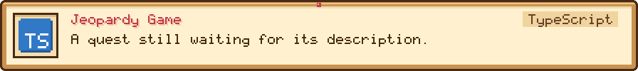
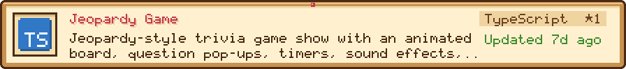
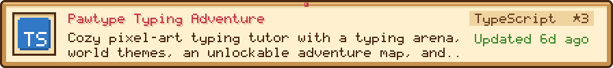
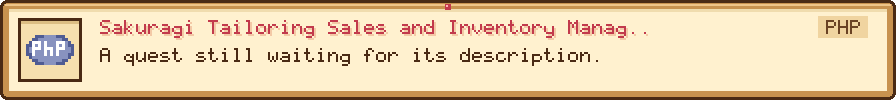

<!-- Generated by scripts/build.mjs from my live GitHub profile. Edit profile.config.json or the scripts, not this file. -->

<picture></picture>

<picture></picture>

<picture></picture>

<picture></picture>

<picture></picture>

  

<picture></picture>

